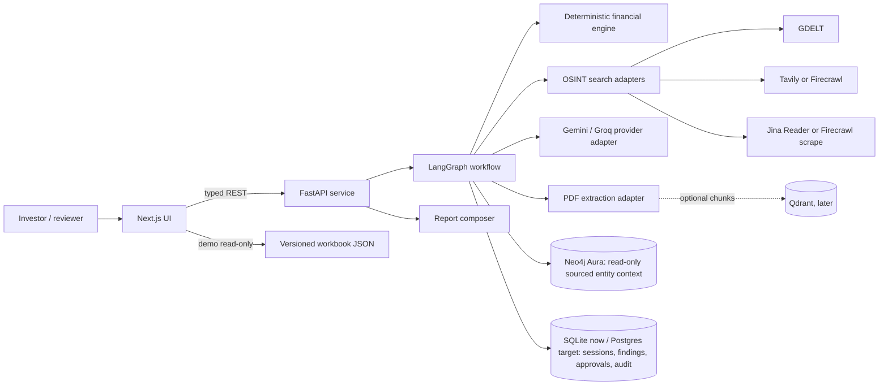

# Implementation Plan: Investor Due Diligence Demo

**Status:** Proposed
**Spec:** [spec.md](spec.md)
**Constitution:** [constitution.md](../../.specify/memory/constitution.md)

## Summary

Retain the existing Next.js 16 / React interface and Excel-to-JSON data path for the immediate demo. The build pipeline now recalculates selected financial metrics from workbook inputs. Continue the separately deployable Python FastAPI service toward the deep-demo milestone: LangGraph orchestration, provider adapters, persistent review/audit records, and deterministic optimization. Keep document OCR in-browser by default and do not send private PDF text to a hosted LLM without explicit consent.

## Current state versus target

| Area | Current repo | Target deep demo |
|---|---|---|
| UI | Next.js 16 App Router, React 19, TypeScript | Keep; connect through typed API client |
| Stock directory | `/stocks` lists all currently configured workbook records; four-symbol preset initializes demo | Keep directory independent from demo preset; add server-side filters/cursor pagination and completeness status as universe grows |
| Data | Workbook currently generates 4 fully loaded company records before dev/build; alternate-workbook candidates are not imported | Keep as versioned demo fixture; later add repository/database and validated import pipeline |
| Backend foundation | FastAPI service with company directory, provenance metadata, pending-ticker registry, SQLite | Split route modules, add auth, Postgres persistence, review/audit, async jobs, and optimizer |
| OSINT | FastAPI LangGraph calls GDELT, Firecrawl/Tavily, Jina Reader, Gemini/Groq; Next Route Handler forwards; optional read-only Neo4j company/event context | Persisted provider results, durable reviewer approval/audit, job queue and tenant-scoped access |
| PDF | Browser PDF.js/Tesseract OCR + deterministic 9-field BCTC parser | Keep local extraction; optional consented LLM extraction over page chunks with schema/evidence validation |
| Portfolio | Prebuilt workbook scenarios and classical-labelled data | FastAPI deterministic bounded optimizer; covariance only with valid adjusted-price series |
| Workflow | FastAPI LangGraph `discover → graph_enrichment → extract → classify → validate`; no durable checkpoint yet | Add Postgres checkpoint, bounded retries/cancellation, persisted human-review interrupt and audit |
| Persistence | No persistent review/session store | SQLite for local demo audit; Postgres when deployed/shared |
| Retrieval | None | Start with cited page/chunk retrieval; add Qdrant only for multi-document semantic retrieval |

## Proposed logical architecture

## Service boundaries

### Frontend — existing Next.js app

- Owns presentation, selection, charts, local OCR by default, reviewer actions, scenario comparison, and print/export.
- `/stocks` is the scalable directory/selection surface. Four default tickers are a scenario preset, not a route or product maximum. Detailed charts/evidence remain on `/company/[ticker]` and portfolio pages.
- Do not expose an added ticker as analysis-ready until required source fields are validated; show a data-completeness state for partial records.
- Calls the backend through `src/lib/api.ts` or a dedicated typed client; no component calls external providers.
- Secrets are never exposed as `NEXT_PUBLIC_*` values.

### Backend — proposed FastAPI service

- `domain/`: typed domain records and validation.
- `services/financial/`: Altman, CAPM, RFin/POSINT, portfolio objective and independent constraint validation.
- `services/osint/`: search/read adapters, canonicalization, deduplication, candidate extraction and evidence validation.
- `services/documents/`: optional server extraction only when explicitly enabled; local browser processing remains default.
- `agents/`: LangGraph state graph; each node calls a narrow service, not arbitrary tools.
- `services/neo4j.py`: parameterized allow-listed reads; never execute LLM-generated Cypher. Explicit workbook demo import is tagged and write-gated.
- `repositories/`: workbook fixture, SQLite/Postgres persistence, optional Qdrant.
- `services/reporting/`: compose reports from approved structured results only.

## OSINT workflow graph

`create session → resolve company → parallel source search → normalize/deduplicate → fetch source content → LLM proposes typed fields with quotes → validate URL/date/quote → reviewer interrupt → approve/reject/adjust → deterministic POSINT → append audit event → return impact`

Rules: tool allowlist only; retrieved content is untrusted; no LLM-created URLs or source dates; source text must support each extracted claim; scan reruns are idempotent; only approved records affect score.

## PDF workflow graph

`select target company → validate PDFs → local text/OCR → page chunks with citations → (optional explicit external-LLM consent) structured extraction → schema/unit/evidence validation → conflict detection → reviewer approval → apply to private assessment → report`

PDF content is never instructions. Local parser output remains the baseline. LLM output is `proposed`, never auto-applied.

## External service choices

- Discovery: use GDELT for broad news/timeline signals and **one** targeted search provider (existing Firecrawl or Tavily). Do not call all search services for every request in the first iteration.
- Extraction: use Firecrawl scrape output or Jina Reader for the chosen URL; do not use both unless a fallback is explicitly needed.
- LLM: one provider adapter with `AI_PROVIDER=groq|gemini`; validate JSON output in domain code. Allow model ID override in server config.
- Orchestration: LangGraph in Python because state/checkpoint/HITL are central to this demo. Do not build free-form multi-agent delegation.
- Vector search: defer Qdrant until multiple documents and semantic retrieval are required. Use page-indexed chunks and simple retrieval first.
- Graph DB: defer Neo4j until relationship evidence and a graph-centric investor use case are available.
- Scrapy/Playwright: defer custom crawlers; prefer source APIs and search/scrape adapters. Use Playwright for E2E browser automation, not as a general crawler.

## Data and API strategy

- Preserve current workbook data as `demo-v1`, including its unresolved notes. Store source/version/as-of metadata with every response.
- The company universe is a data registry, not an array hard-coded into page components. New symbols require validated company, financial, ESG/OSINT, and market inputs; unsupported metrics remain missing.
- Portfolio selection capacity is independent from stock-directory size. The active solver policy owns asset limits and weight bounds; validate `n × min_weight ≤ 1 ≤ n × max_weight` before optimization.
- For larger universes, `/companies` must use server-side search/filter and cursor pagination. Batch OSINT should become an asynchronous job rather than one long request.
- API contracts are in [contracts/openapi.yaml](contracts/openapi.yaml); domain records are in [data-model.md](data-model.md).
- Avoid mutating public data from private assessments. Use assessment/session-scoped overrides.
- Session/audit persistence is needed before calling reviewer actions “approved” across sessions.

## Deployment plan

1. **Local demo:** Next.js + mock JSON + optional Firecrawl; no backend required.
2. **Deep demo:** Next.js + FastAPI/LangGraph + SQLite; external providers configured only in server env; GDELT can be keyless, Tavily/Firecrawl/Jina/LLM credentials remain server-side.
3. **Team demo:** Postgres, access control, retention policy, encrypted object storage only if server-side PDFs become a requirement; Qdrant only if retrieval needs justify it.

## Constitution check

- Evidence provenance: satisfied by source/evidence fields and approval gate in the target records.
- Deterministic calculations: all scores/weights in financial service, never LLM prompts.
- Privacy: browser processing remains default; external LLM processing requires explicit consent.
- Honest labeling: fixture/live/provider/methodology metadata are required.
- Incremental architecture: existing UI and data pipeline are preserved; backend is a separate milestone.

## Open decisions before implementation

1. Which source becomes the primary search provider: keep Firecrawl or switch to Tavily?
2. The workbook currently contains four complete records; which source/version should be approved to import the five additional AQ_Input candidates (MCH, QNS, KDC, PAN, IDP)?
3. Confirm OSINT severity mapping for contested MCM event and any other open workbook rows.
4. Decide whether the demo may send public article text to a free-tier model; private PDF text remains local unless explicitly approved.
5. Select covariance period/frequency and capital/weight constraints for a real recalculation run.
