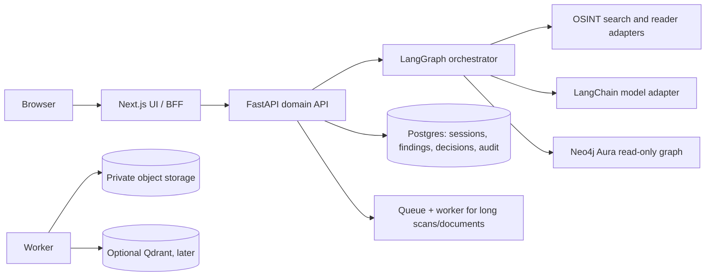

# Implementation Plan: Agent Platform

**Status:** Active, incremental
**Spec:** [spec.md](spec.md)

## Deployment shape

## Boundaries

- `src/`: UI and same-origin BFF routes only. BFF validates requests and forwards to FastAPI; it does not own domain workflows.
- `backend/app/api/`: versioned HTTP contracts, authentication, validation, rate limits.
- `backend/app/agents/`: LangGraph state machines and tool policy; nodes call adapters, not provider SDKs directly.
- `backend/app/services/`: Neo4j, search, model, financial, document, and reporting adapters.
- `backend/app/domain/`: typed entities and deterministic business rules.
- `backend/app/repositories/`: persistence interfaces; PostgreSQL implementation replaces demo SQLite when shared deployment begins.
- `backend/workers/`: queue consumers for long scans, PDF OCR/LLM, and report creation.
- `data/`: source workbook only. Generated `src/data/*.json` remains a demo fixture, not the eventual system of record.

## Data and control flow

`request → auth/tenant guard → create scan record → resolve company → search providers → read-only Neo4j entity context → bounded extraction → LLM structured proposal → deterministic evidence validation → reviewer decision → deterministic POSINT update → append audit record`

LangGraph checkpointer stores workflow state in PostgreSQL for deployed use. Never persist raw private PDF text in general logs. Model context receives only the minimum public text required for the task. A tool allow-list and per-node timeout/iteration budget are mandatory.

## Neo4j integration shipped in this slice

- Python Neo4j driver adapter has connection diagnostics and an allow-listed company/event lookup.
- The current OSINT graph reads Neo4j context before extraction/classification. It does not run generated Cypher and does not write to Aura.
- A deliberate seed command imports only workbook demo `Company` and `Event` nodes, tagged with `provenance=workbook_demo` and `demo=true`. Writes require `NEO4J_ALLOW_DEMO_WRITE=true`.
- The connected Aura database currently has zero nodes. The application should report connected-but-empty until the seed command is explicitly run.
- Neo4j Aura hosted MCP is for an MCP-compatible IDE/client and uses the instance MCP URL plus browser OAuth. The application’s backend uses the direct driver so its service identity and query surface remain controlled. No Aura API client secret is used as a database password.

## Configuration and deployment

- Local monorepo: root `.env.local` is outside `src/`, ignored by Git, and loaded by Next.js and FastAPI. Keep private service credentials here for the local demo; use `NEO4J_CREDENTIALS_FILE` to reference the external credentials file without copying the database password.
- Production: set variables in each hosting provider’s runtime secret manager. Vercel gets only the public web settings and server-side BFF URL; the API host gets LLM/search/Neo4j secrets. Never add deployment secrets to a build artifact or `NEXT_PUBLIC_*` variable.
- Recommended first deployment: Vercel for Next.js, a container host such as Render/Fly.io/Cloud Run for FastAPI, Neo4j Aura for the graph, managed PostgreSQL for shared state. Deploying separately gives independent scaling and secret boundaries; local development remains one repo and two processes.
- Add Redis/managed queue only when scans exceed request timeouts or PDF jobs require background processing.

## Rollout gates

1. Local deep demo: database adapter, OSINT graph workflow, human review preview.
2. Shared pilot: auth/tenant model, Postgres repositories/checkpointing, audit records, async workers, observability and request limits.
3. Production: security review, data retention policy, provider contracts, backups, restore drill, migration pipeline and load tests.
